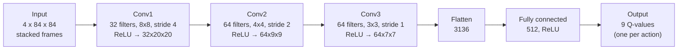
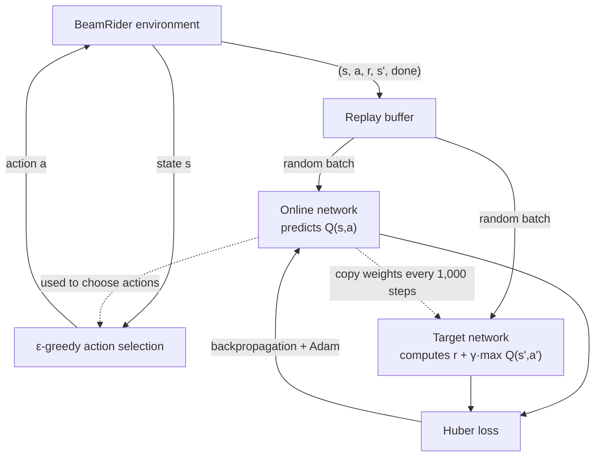
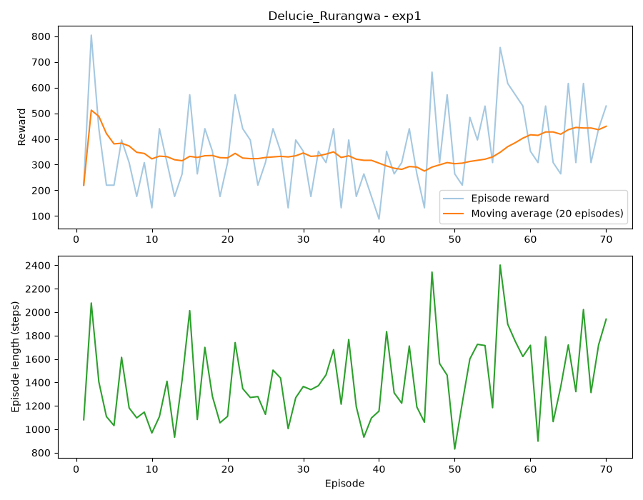

# Deep Q-Network (DQN) on Atari BeamRider

## Project Introduction
We built a Deep Q-Network agent **from scratch** with PyTorch and Gymnasium (no Stable-Baselines3 or any ready-made DQN library). The agent learns to play **BeamRider** only by looking at the screen pixels and receiving the game score as reward.

### Group members
| Name | Role |
|---|---|
| Delucie Rurangwa | DQN implementation, 10 experiments (learning rate, gamma, batch size) |
| Favor Ekep-Obasi Ayuk | play.py, README/plots, 10 experiments (epsilon / exploration) |

See `Task allocation sheet.pdf` for the full split of work.

### Selected Atari environment
**`ALE/BeamRider-v5`** — a 3D space shooter. The agent flies a ship at the bottom of the screen and moves between 5 beams (lanes). Enemy saucers come down the beams; the agent shoots them with lasers and dodges enemy shots and debris. After 15 enemies are destroyed in a sector, a mothership appears and the next sector begins. The player starts with 3 lives.
**Goal:** destroy as many enemies as possible (maximise the score) and survive as long as possible.
Actions (9): `NOOP`, `FIRE`, `UP` (torpedo), `RIGHT`, `LEFT`, `UPRIGHT`, `UPLEFT`, `RIGHTFIRE`, `LEFTFIRE`.
A random agent scores about 250–400 points per game, so any score clearly above that shows learning.

## DQN Architecture

### Preprocessing
Each game frame is converted to grayscale, resized to 84×84, every action is repeated for 4 frames, and the last 4 frames are stacked. Stacking lets the network see the **direction and speed** of enemies and shots. Input shape: `(4, 84, 84)`.

### Q-Network (CNN)


### Online network and target network


### Training process
1. **Play:** the agent chooses an action with **ε-greedy** — random action with probability ε (explore), best Q-value action otherwise (exploit). ε decreases linearly from *epsilon start* to *epsilon end* over *epsilon decay* steps.
2. **Store:** every experience `(state, action, reward, next_state, done)` goes into the **replay buffer** (30,000 experiences). Rewards are clipped to -1, 0, +1.
3. **Learn (every 4 steps):** sample a random batch. The online network predicts `Q(s, a)`. The target network gives the **Bellman target**
   `target = r + γ · max_a' Q_target(s', a')` (just `r` if the game ended).
4. **Update:** Huber loss between prediction and target → backpropagation → Adam optimizer updates the online network.
5. **Target update:** every 1,000 steps the online weights are copied into the target network so the targets stay stable.
6. **Save:** model (`dqn_model.pth`), training log (episode, total steps, episode length, reward, epsilon) and training plot.

## How to run (uv)
```bash
uv sync                                   # install everything
uv run train.py --member Delucie_Rurangwa --exp exp1 --lr 0.0001 --gamma 0.99 --batch-size 32 --eps-start 1.0 --eps-end 0.05 --eps-decay 100000
uv run run_experiments.py --member delucie  # Delucie's 10 experiments
uv run run_experiments.py --member favor    # Favor's 10 experiments
uv run play.py                            # watch the best agent play (uses dqn_model.pth)
```
Each experiment is saved in `models/<member name>/<exp>/`:
`dqn_model.pth`, `training_log.csv`, `training_plot.png`, `summary.json`.
The best model is copied to the repo root as `dqn_model.pth`.

## Hyperparameter experiments
- [Delucie Rurangwa — results](Delucie_Rurangwa_Hyperparameter_experiment_results.md)
- [Favor Ekep-Obasi Ayuk — results](Favor_Ekep-Obasi_Ayuk_Hyperparameter_experiment_results.md)

## Best experiment — training performance
Best experiment: **_fill in_** (`models/<name>/<exp>/`)



| Metric | Value |
|---|---|
| Total steps | 200,000 |
| Episodes played | _fill in_ |
| Average episode length (last 20) | _fill in_ |
| Average reward (last 20 episodes) | _fill in_ |
| Best episode reward | _fill in_ |

## Gameplay Demonstration
Video of the best agent: **_add video link here_**
